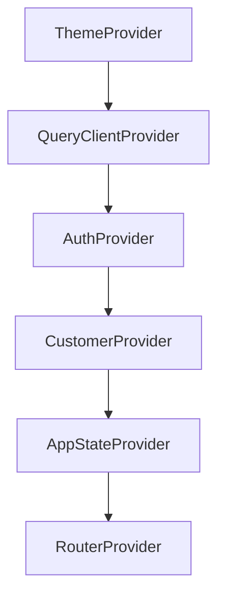
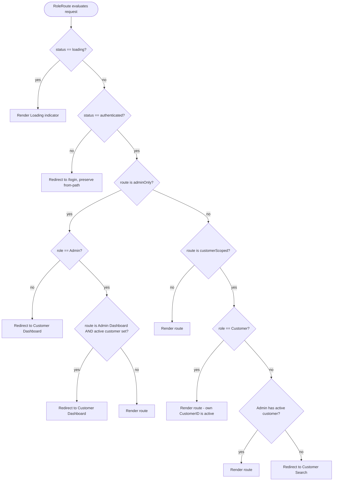
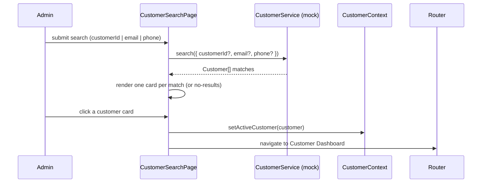

# Design Document: Phase 2 — Auth, RBAC & Customer Context

## Overview

Phase 2 layers role-based authentication, a users domain, a global customer context, admin-driven customer management, role-aware dashboards, and role-based access control onto the completed Phase 1 foundation. It also reshapes the AI Assistant request into a role-and-customer-scoped `Chat_Payload` — without connecting any AI backend.

The guiding principle is **extend, do not rewrite**. Every Phase 1 building block is reused as-is or evolved in place behind its existing seam:

- The Phase 1 `AuthClient` interface + `PlaceholderAuthClient` evolves into a richer `AuthService` interface + `MockAuthService` that validates credentials against mock `User` records and returns a `Role` + `CustomerID`. The existing `authBridge` wiring, `useAuth` hook, and provider lifecycle are preserved.
- The interface-first services pattern (`ai`, `orders`, `returns`, `payments`, `support`, `profile`) is reused verbatim for three new domains: `users`, `customers`, and `auth`.
- The routing stack (`paths.ts`, `navItems.ts`, `ProtectedRoute`, `router.tsx`, `AppLayout`, `Sidebar`, `TopNavbar`) is extended with admin paths, a `RoleRoute` guard, role-aware nav derivation, and an admin route subtree — all still rendered under the single `AppLayout`.
- A new `CustomerContext` sits inside `AuthProvider` (it depends on auth) and coordinates clearing on sign-out.

Everything remains **mock-only**: no Amazon Cognito, no Amazon API Gateway, no AWS SDK. Each new domain is defined behind a TypeScript interface so a Cognito-/API-Gateway-backed implementation can be swapped in later without touching a single consumer. The application must compile at all times, honoring the Phase 1 conventions: `verbatimModuleSyntax` (so `import type` for type-only imports), the `@/` path alias, no `React.JSX.Element` return annotations, and HeroUI v3 (which ships no provider).

### Requirements addressed

This design satisfies Requirements 1–13. A design-decision-to-requirements mapping is provided at the end of the document.

## Architecture

### Provider composition

`CustomerProvider` is added **inside** `AuthProvider` because the customer context reacts to auth status (it clears on sign-out and restores on startup once auth is resolved). It sits **outside** `AppStateProvider` and the router so every routed page and guard can read it.



Provider order (outermost → innermost): **ThemeProvider → QueryClientProvider → AuthProvider → CustomerProvider → AppStateProvider → RouterProvider**.

### Layered structure

```mermaid
graph TD
    subgraph Pages
        Login[LoginPage]
        CustDash[CustomerDashboard]
        AdminDash[AdminDashboard]
        Search[CustomerSearchPage]
        AI[AIAssistantPage]
    end
    subgraph Routing
        RoleRoute[RoleRoute guard]
        Router[router.tsx]
        NavItems[navItems derivation]
    end
    subgraph Contexts
        AuthCtx[AuthContext]
        CustCtx[CustomerContext]
    end
    subgraph Services (interface-first, mock)
        AuthSvc[AuthService / MockAuthService]
        UserSvc[UserService / MockUserService]
        CustSvc[CustomerService / MockCustomerService]
        ChatSvc[AiChatService]
    end

    Login --> AuthCtx
    AuthCtx --> AuthSvc
    AuthSvc --> UserSvc
    CustDash --> CustCtx
    AdminDash --> CustCtx
    Search --> CustSvc
    Search --> CustCtx
    AI --> AuthCtx
    AI --> CustCtx
    AI --> ChatSvc
    RoleRoute --> AuthCtx
    RoleRoute --> CustCtx
    Router --> RoleRoute
    NavItems --> AuthCtx
    NavItems --> CustCtx
```

### Role-based routing decision flow

The `RoleRoute` guard centralizes all access decisions. It is parameterized by what a route requires: `adminOnly` (Admin_Dashboard, Customer_Search) or `customerScoped` (Orders, Returns, Payments, Support, Profile, AI Assistant, Customer_Dashboard).



### Login sequence — Customer

```mermaid
sequenceDiagram
    participant U as User
    participant L as LoginPage
    participant A as AuthContext
    participant AS as AuthService (mock)
    participant US as UserService (mock)
    participant C as CustomerContext
    participant CS as CustomerService (mock)

    U->>L: submit email + password
    L->>A: signIn({ email, password })
    A->>AS: signIn(credentials)
    AS->>US: validateCredentials(email, password)
    US-->>AS: User (role=Customer, customerId)
    AS-->>A: AuthenticatedUser (role, customerId)
    A->>A: set status=authenticated, user, role; persist session
    A-->>L: resolve
    L->>C: (effect) role=Customer -> load own customer
    C->>CS: getById(customerId)
    CS-->>C: Customer
    C->>C: setActiveCustomer(customer)
    L->>L: navigate to Customer Dashboard
```

### Login sequence — Admin

```mermaid
sequenceDiagram
    participant U as User
    participant L as LoginPage
    participant A as AuthContext
    participant AS as AuthService (mock)
    participant US as UserService (mock)
    participant C as CustomerContext

    U->>L: submit email + password
    L->>A: signIn({ email, password })
    A->>AS: signIn(credentials)
    AS->>US: validateCredentials(email, password)
    US-->>AS: User (role=Admin, customerId=null)
    AS-->>A: AuthenticatedUser (role=Admin, customerId=null)
    A->>A: set status=authenticated, role=Admin; persist session
    A-->>L: resolve
    Note over C: no active customer set (customerId stays null)
    L->>L: navigate to Admin Dashboard
```

### Admin select-customer flow



### Sign-out coordination

Sign-out must clear both contexts. The mechanism: `CustomerProvider` subscribes to `AuthContext` status via `useAuth()` and runs an effect that calls `clearActiveCustomer()` whenever status transitions to `unauthenticated`. `AuthContext.signOut()` remains the single entry point — it clears auth state, removes persisted session data, and the transition to `unauthenticated` triggers the customer clear. This keeps the two contexts decoupled (Customer depends on Auth, never the reverse). Navigation to `/login` is performed by the caller (`TopNavbar` sign-out handler) after `signOut()` resolves.

## Components and Interfaces

### New / changed file list

| File | Status | Responsibility |
| --- | --- | --- |
| `src/types/user.ts` | new | `Role`, `UserStatus`, `User`, `Credentials` types |
| `src/types/customer.ts` | new | `Customer` type, `CustomerSearchQuery` type |
| `src/types/auth.ts` | changed | add `role`, `customerId` to `AuthUser`; extend `AuthContextValue` (`role`, `signIn(credentials)`); extend `AuthClient`→`AuthService` |
| `src/types/chat.ts` | changed | add `Role`-scoped `ChatPayload`; extend `SendMessageRequest` inputs |
| `src/services/users/userService.ts` | new | `UserService` interface + `MockUserService` + mock user records |
| `src/services/users/index.ts` | new | barrel export |
| `src/services/customers/customerService.ts` | new | `CustomerService` interface + `MockCustomerService` + mock customer records |
| `src/services/customers/index.ts` | new | barrel export |
| `src/services/auth/authService.ts` | new | `AuthService` interface + `MockAuthService` (uses `UserService`) |
| `src/services/auth/session.ts` | new | pure session persistence helpers (serialize/parse/read/write/clear) |
| `src/services/auth/index.ts` | new | barrel export |
| `src/services/index.ts` | changed | re-export `users`, `customers`, `auth` |
| `src/services/ai/aiChatService.ts` | changed | accept/assemble `ChatPayload`; enforce role/customer rules |
| `src/contexts/AuthContext.tsx` | changed | store role + customerId; `signIn(credentials)`; session persistence; use `MockAuthService` |
| `src/contexts/CustomerContext.tsx` | new | `CustomerProvider`, `useCustomer`, active-customer + selections state, clear-on-signout effect, restore-on-startup |
| `src/routes/paths.ts` | changed | add `adminDashboard`, `customerSearch` |
| `src/routes/navItems.ts` | changed | export role-aware `getNavItems(role, hasActiveCustomer)` |
| `src/routes/RoleRoute.tsx` | new | role + customer-context access guard |
| `src/routes/redirect.ts` | new | pure `resolvePostLoginPath(role)` + `resolveRouteAccess(...)` decision function |
| `src/routes/router.tsx` | changed | admin vs customer route subtrees under `AppLayout` |
| `src/routes/index.ts` | changed | export `RoleRoute`, redirect helpers |
| `src/components/layout/Sidebar.tsx` | changed | derive items from role + active customer via `getNavItems` |
| `src/pages/Dashboard/DashboardPage.tsx` | changed | Customer Dashboard reads from `CustomerContext` |
| `src/pages/AdminDashboard/AdminDashboardPage.tsx` | new | admin dashboard |
| `src/pages/CustomerSearch/CustomerSearchPage.tsx` | new | admin customer search |
| `src/pages/Login/LoginPage.tsx` | changed | credential validation, error display, redirect-by-role |
| `src/pages/AIAssistant/AIAssistantPage.tsx` | changed | build `ChatPayload` from `useAuth` + `useCustomer` |
| `src/App.tsx` | changed | insert `CustomerProvider` inside `AuthProvider` |

### Auth service interface (evolved from Phase 1 `AuthClient`)

```typescript
// src/types/auth.ts (additions/changes)
import type { Role, User } from "@/types/user";

export type AuthStatus = "loading" | "authenticated" | "unauthenticated";

export interface AuthUser {
  id: string;
  displayName: string;
  email?: string;
  role: Role;                 // NEW
  customerId: string | null;  // NEW (null for Admin)
}

export interface Credentials {
  email: string;
  password: string;
}

export interface AuthContextValue {
  status: AuthStatus;
  user: AuthUser | null;
  role: Role | null;                          // NEW typed accessor
  getToken: () => string | null;
  signIn: (credentials: Credentials) => Promise<AuthUser>; // CHANGED: takes credentials, returns user
  signOut: () => Promise<void>;
  refreshSession: () => Promise<void>;
}

// AuthClient evolves into AuthService
export interface AuthService {
  getSession(): Promise<AuthUser | null>;
  signIn(credentials: Credentials): Promise<AuthUser>; // throws AuthError on invalid
  signOut(): Promise<void>;
  getToken(): string | null;
}
```

`signIn` now returns the authenticated `AuthUser` so the caller (`LoginPage`) can redirect by role without a second read. On invalid credentials it rejects with a typed `AuthError`.

### User service interface

```typescript
// src/services/users/userService.ts
import type { User, Credentials } from "@/types/user";

export type FindResult =
  | { found: true; user: User }
  | { found: false };

export interface UserService {
  findByEmail(email: string): Promise<FindResult>;
  getById(userId: string): Promise<User | null>;
  validateCredentials(credentials: Credentials): Promise<FindResult>;
}

export const userService: UserService = new MockUserService();
```

`MockUserService` holds an in-memory array with at least one `Customer` and one `Admin`. `findByEmail` returns a match regardless of `Status`/`Role`. Credential validation is mock: password checked against a per-user mock password map (never persisted).

### Customer service interface

```typescript
// src/services/customers/customerService.ts
import type { Customer, CustomerSearchQuery } from "@/types/customer";

export interface CustomerService {
  getById(customerId: string): Promise<Customer | null>;
  search(query: CustomerSearchQuery): Promise<Customer[]>;
}

export const customerService: CustomerService = new MockCustomerService();
```

`search` matches by any provided field (`customerId`, `email`, or `phone`), case-insensitively for email, exact for id/phone. Absent fields are ignored; an all-empty query returns an empty list.

### Auth service (mock) composition

```typescript
// src/services/auth/authService.ts
export class MockAuthService implements AuthService {
  constructor(private readonly users: UserService) {}
  async signIn(credentials: Credentials): Promise<AuthUser> {
    const result = await this.users.validateCredentials(credentials);
    if (!result.found) throw new AuthError("Invalid email or password.");
    return toAuthUser(result.user); // maps User -> AuthUser (role, customerId)
  }
  // getSession/getToken/signOut back the mock session
}
```

### Customer context interface

```typescript
// src/contexts/CustomerContext.tsx
export interface CustomerContextValue {
  customerId: string | null;
  name: string | null;
  email: string | null;
  phone: string | null;
  selectedOrder: Order | null;
  selectedSupportTicket: Ticket | null;
  setActiveCustomer: (customer: Customer) => void;
  clearActiveCustomer: () => void;
  setSelectedOrder: (order: Order | null) => void;
  setSelectedSupportTicket: (ticket: Ticket | null) => void;
}

export function useCustomer(): CustomerContextValue;
```

`useCustomer` throws a descriptive error when used outside `CustomerProvider` (mirroring `useAuth`/`useAppState`). `selectedOrder`/`selectedSupportTicket` reuse the existing `Order` (orders service) and `Ticket` (support service) types.

### RoleRoute guard

```typescript
// src/routes/RoleRoute.tsx
export interface RoleRouteProps {
  children: ReactNode;
  adminOnly?: boolean;
  customerScoped?: boolean;
}
```

`RoleRoute` reads `useAuth()` (`status`, `role`) and `useCustomer()` (`customerId`), delegates the decision to the pure `resolveRouteAccess(...)` function in `redirect.ts`, and renders `Loading`, a `<Navigate>`, or the children accordingly. It preserves the requested path in navigation state on the unauthenticated redirect (same technique as Phase 1 `ProtectedRoute`). `ProtectedRoute` is retained for any purely-auth route but the app routes use `RoleRoute`.

### Pure routing decision function

```typescript
// src/routes/redirect.ts
export type RouteKind = "public" | "adminOnly" | "customerScoped" | "authOnly";

export interface AccessInput {
  status: AuthStatus;
  role: Role | null;
  hasActiveCustomer: boolean;
  routeKind: RouteKind;
  isAdminDashboard: boolean;
}

export type AccessDecision =
  | { type: "loading" }
  | { type: "redirect"; to: string }
  | { type: "allow" };

export function resolveRouteAccess(input: AccessInput): AccessDecision;
export function resolvePostLoginPath(role: Role): string; // Customer->dashboard, Admin->adminDashboard
```

Extracting the decision as a pure, total function makes the entire RBAC matrix property-testable without rendering React.

### Role-aware navigation

```typescript
// src/routes/navItems.ts
export function getNavItems(role: Role | null, hasActiveCustomer: boolean): NavItem[];
```

`Sidebar` calls `getNavItems(role, hasActiveCustomer)` (via `useAuth` + `useCustomer`) instead of importing the static `NAV_ITEMS`. Customer role → customer nav set (no admin items). Admin with no active customer → `[Admin Dashboard, Customer Search]`. Admin with active customer → admin items + customer-scoped items for the active customer.

### AI Assistant payload assembly

```typescript
// src/services/ai/aiChatService.ts
export interface AiChatService {
  sendMessage(payload: ChatPayload): Promise<SendMessageResponse>;
}
```

The page assembles the payload; the service still validates the role/customer invariants and rejects when they are violated (defense in depth). A pure helper `buildChatPayload(role, customerId, message)` returns either a valid `ChatPayload` or a rejection reason, and is shared by the page and testable in isolation.

## Data Models

```typescript
// src/types/user.ts
export type Role = "Customer" | "Admin";
export type UserStatus = "active" | "inactive" | "suspended";

export interface User {
  UserID: string;
  CustomerID: string | null; // null when Role === "Admin"
  Name: string;
  Email: string;
  Role: Role;
  Status: UserStatus;
}

export interface Credentials {
  email: string;
  password: string;
}
```

```typescript
// src/types/customer.ts
export interface Customer {
  CustomerID: string;
  Name: string;
  Email: string;
  Phone: string;
}

export interface CustomerSearchQuery {
  customerId?: string;
  email?: string;
  phone?: string;
}
```

```typescript
// src/types/chat.ts (additions)
import type { Role } from "@/types/user";

export interface ChatPayload {
  role: Role;
  customerId: string | null;
  message: string;
}
```

```typescript
// Session persistence shape (src/services/auth/session.ts)
export interface PersistedSession {
  status: "authenticated";
  role: Role;
  userId: string;
  customerId: string | null;
}
```

### Model invariants

- `User.CustomerID` is `null` iff `User.Role === "Admin"` (Req 2.2).
- `AuthUser.customerId` mirrors the source `User.CustomerID`.
- `CustomerContext.customerId === null` iff no active customer (Req 5.5, 5.6).
- `ChatPayload.role` always equals the active auth `Role` (Req 10.6, 10.7).

### Mapping to future AWS backends

| Mock (Phase 2) | Future (later phase) |
| --- | --- |
| `MockAuthService` | `CognitoAuthService` (Cognito user pools, tokens) |
| `MockUserService` | `ApiUserService` (API Gateway `/users`) |
| `MockCustomerService` | `ApiCustomerService` (API Gateway `/customers`) |
| `session.ts` localStorage | Cognito session / secure token storage |
| `aiChatService` canned reply | Bedrock/Lex-backed `/ai/messages` |

Because every consumer depends only on the interface and the exported singleton, swapping the concrete class is the only change required.

## Correctness Properties

*A property is a characteristic or behavior that should hold true across all valid executions of a system — essentially, a formal statement about what the system should do. Properties serve as the bridge between human-readable specifications and machine-verifiable correctness guarantees.*

The following properties were derived from the acceptance criteria after prework classification and a redundancy reflection that consolidated the many RBAC/redirect/nav/payload criteria into single comprehensive properties. They target the pure decision functions (`resolveRouteAccess`, `resolvePostLoginPath`, `getNavItems`, `buildChatPayload`, session helpers) and the mock service/context logic — all of which are pure or in-memory and cheap to run 100+ times.

### Property 1: RBAC access decision matrix

*For any* combination of authentication status, role (`Customer`/`Admin`/`null`), active-customer presence, and route kind (`public`/`authOnly`/`adminOnly`/`customerScoped`, plus the `isAdminDashboard` flag), `resolveRouteAccess` returns exactly one decision consistent with the rules: `loading` while status is loading; `redirect` to login when unauthenticated on a guarded route; `redirect` to Customer Dashboard when a Customer requests an admin-only route; `redirect` to Customer Search when an Admin with no active customer requests a customer-scoped route; `redirect` to Customer Dashboard when an Admin with an active customer requests the Admin Dashboard; and `allow` in all authorized cases (Customer on customer-scoped, Admin on admin-only without the admin-dashboard+active conflict, any role on public).

**Validates: Requirements 6.1, 7.3, 7.4, 9.1, 9.2, 9.5, 9.6, 9.7, 9.8**

### Property 2: Redirect-by-role after login

*For any* role, `resolvePostLoginPath` returns the Customer Dashboard path when the role is `Customer` and the Admin Dashboard path when the role is `Admin`.

**Validates: Requirements 3.4, 4.6, 9.3, 9.4**

### Property 3: Navigation derivation from role and active customer

*For any* combination of role and active-customer presence, `getNavItems` returns items consistent with the rules: a `Customer` role yields the customer navigation set and never includes any admin-only path; an `Admin` with no active customer yields exactly Admin Dashboard and Customer Search; an `Admin` with an active customer additionally yields the customer-scoped items.

**Validates: Requirements 8.1, 8.2, 8.3, 8.4**

### Property 4: User CustomerID/Role invariant

*For any* `User` record produced by the User_Service, `CustomerID` is `null` if and only if `Role` is `Admin`.

**Validates: Requirements 1.1, 2.1, 2.2**

### Property 5: findByEmail correctness

*For any* email, `findByEmail` returns `found=true` with the matching user when that email exists in the store (regardless of the user's Status or Role), and returns `found=false` when the email does not exist.

**Validates: Requirements 2.5, 2.6**

### Property 6: Credential validation correctness

*For any* email/password pair, `validateCredentials` returns `found=true` with the user if and only if the pair matches a stored user's credentials, and `found=false` otherwise.

**Validates: Requirements 3.1, 4.1**

### Property 7: setActiveCustomer round-trip

*For any* `Customer` record, after `setActiveCustomer(customer)` the Customer_Context reports `customerId`, `name`, `email`, and `phone` equal to the record's fields, with `customerId` equal to the record's non-null `CustomerID`.

**Validates: Requirements 5.1, 5.2, 5.3, 5.5, 5.6**

### Property 8: clearActiveCustomer reset and idempotence

*For any* prior Customer_Context state, after `clearActiveCustomer()` the `customerId` is `null` and `selectedOrder` and `selectedSupportTicket` are `null`; applying `clearActiveCustomer()` again produces the same state (idempotence).

**Validates: Requirements 5.4, 12.2**

### Property 9: Customer search matching

*For any* set of `Customer` records and any `CustomerSearchQuery` (any subset of `customerId`, `email`, `phone`), every record returned by `search` matches all provided query fields, and every stored record that matches all provided fields is returned.

**Validates: Requirements 6.2**

### Property 10: Search result render completeness

*For any* list of `Customer` records, the Customer_Search_Page renders exactly one customer card per record, and each card contains that record's Name, CustomerID, Email, and Phone.

**Validates: Requirements 6.3**

### Property 11: Results/no-results mutual exclusivity

*For any* search result list, the Customer_Search_Page displays customer cards when the list is non-empty and the no-results message when the list is empty, and never displays both at once (exactly one of the two states holds).

**Validates: Requirements 6.4, 6.5, 6.8**

### Property 12: Chat payload assembly

*For any* role, active `customerId` (or `null`), and message, `buildChatPayload` produces a payload whose `role` equals the active role and whose `customerId` is: the Customer's own non-null CustomerID when the role is `Customer`; the active customer's CustomerID when the role is `Admin` with an active customer; and `null` when the role is `Admin` with no active customer. When the role is `Customer` and no active customer is available, it produces a rejection and no payload.

**Validates: Requirements 10.1, 10.2, 10.3, 10.4, 10.5, 10.6**

### Property 13: Chat role-mismatch rejection

*For any* `ChatPayload` whose `role` differs from the active role in the Auth_Context, `aiChatService.sendMessage` rejects the message and sends no payload.

**Validates: Requirements 10.7**

### Property 14: Session persistence round-trip

*For any* valid `PersistedSession` (status, role, userId, customerId), writing it to the Session_Store and then reading it back yields an equivalent session.

**Validates: Requirements 13.1, 13.2**

### Property 15: Session malformed-input robustness

*For any* arbitrary string stored in the Session_Store (including malformed JSON and structurally invalid objects), reading the session returns `null` (initializing as unauthenticated with no active customer) and never throws.

**Validates: Requirements 13.4**

## Error Handling

- **Invalid credentials (Req 3.2, 4.2):** `MockAuthService.signIn` rejects with a typed `AuthError` carrying a user-facing message. `LoginPage` catches it, renders the message inline, and stays on `/login`. A subsequent successful sign-in clears the message (Req 4.3).
- **Customer load failure after login (Req 3.6):** If `CustomerService.getById` rejects or returns `null` during post-login customer hydration, the Customer_Dashboard renders the existing `ErrorState` component while the authenticated session is retained (no forced sign-out).
- **Missing provider (Req 1.5, 5.7):** `useAuth` and `useCustomer` throw descriptive errors naming the missing provider (matching the Phase 1 `useAppState`/`useAuth` pattern). These are programmer errors surfaced as unhandled exceptions during development.
- **Indeterminate dashboard (Req 7.5):** If role is `null` while authenticated (should not occur), dashboards render `ErrorState` rather than guessing a role-specific view.
- **Malformed/absent persisted session (Req 13.4):** `session.readSession` wraps `JSON.parse` and structural validation in a total function that returns `null` on any failure; startup then initializes unauthenticated with no active customer. No exception escapes.
- **Empty/blank search (Req 6.4, 6.8):** An all-empty query yields an empty result list; the page shows the no-results message and renders no selectable cards.
- **AI payload guard (Req 10.5, 10.7):** `buildChatPayload` returns a rejection for a Customer with no active customer; `aiChatService.sendMessage` additionally rejects any payload whose role disagrees with the caller-supplied active role. Rejections surface as a mutation error in the AI Assistant page without sending a request.

## Testing Strategy

Testing follows the Phase 1 stack (Vitest + Testing Library) and adds **fast-check** for property-based tests. Property tests and example/integration tests are complementary: property tests verify universal correctness of the pure decision logic; example and integration tests cover concrete UI flows, wiring, and error branches.

### Property-based tests (fast-check)

- Library: `fast-check` with Vitest. Each property test runs a minimum of **100 iterations**.
- Each property test is tagged with a comment in the format: `// Feature: phase2-auth-rbac-customer-context, Property {number}: {property text}` and references the design property it implements.
- Each of the 15 correctness properties above is implemented as a **single** property-based test:
  - Properties 1–3 target the pure route/nav functions in `redirect.ts` and `navItems.ts` (generators over role, status, active-customer flag, route kind).
  - Properties 4–6, 9 target `MockUserService`/`MockCustomerService` (generators over user/customer records and queries).
  - Properties 7–8 target `CustomerContext` reducer logic (generators over `Customer` records and prior state).
  - Properties 10–11 target the search page render (generators over customer lists) using Testing Library.
  - Properties 12–13 target `buildChatPayload` / `aiChatService` (generators over role, customerId, message).
  - Properties 14–15 target `session.ts` (generators over valid sessions and arbitrary strings).

### Unit / example tests

- Login flows: invalid-credential error display and retention (3.2, 4.2), error clearing on success (4.3), role-specific state storage (3.3, 4.4, 4.5).
- Context provider-guard errors (1.5, 5.7); AuthContext sign-in state transition (1.2, 1.3).
- Customer hydration success and failure (3.5, 3.6); startup restore via `getById` (13.3).
- Card selection sets active customer and navigates (6.6, 6.7); admin/customer dashboard section presence (7.1, 7.2); indeterminate-role error state (7.5).
- Sign-out clears both contexts, clears Session_Store, and navigates to login (12.1, 12.2, 12.3, 12.4).
- Mock data facts: at least one Customer and one Admin (2.3).

### Smoke / architectural tests

- Interface-only dependency and swappability of Auth/User/Customer services (1.4, 2.4, 11.1–11.4).
- No AWS SDK dependency in `package.json` and no AWS network endpoints referenced (11.5, 11.6).
- `tsc`/Vite build compiles with mocks in place (11.7).

### Why not PBT for some criteria

UI-presence assertions (dashboard sections, provider-guard errors), fixed mock-data facts, navigation side effects, and architectural/no-AWS constraints do not vary meaningfully with input, so they are covered by example, integration, or smoke tests rather than property tests.

## Design-Decision-to-Requirements Mapping

| Design decision | Requirements |
| --- | --- |
| `AuthUser`/`AuthContextValue` extended with `role` + `customerId`; `role` accessor | 1.1, 1.2, 1.3 |
| `AuthClient` evolved to `AuthService` interface; `MockAuthService` behind it | 1.4, 11.1, 11.4 |
| `useAuth` throws outside provider (retained) | 1.5 |
| `User` model + `MockUserService` (findByEmail, getById, validateCredentials) | 2.1–2.6 |
| CustomerID/Role invariant enforced in mock data + type | 2.2 |
| `LoginPage` credential validation, error display, redirect-by-role | 3.1–3.4, 4.1–4.6 |
| Customer hydration into `CustomerContext` after login + error state | 3.5, 3.6 |
| `CustomerContext` state, accessors, set/clear operations | 5.1–5.7 |
| `CustomerSearchPage` + `CustomerService.search` + cards | 6.1–6.8 |
| Customer & Admin dashboards, role-based render selection | 7.1–7.5 |
| `getNavItems(role, hasActiveCustomer)` + `Sidebar` derivation | 8.1–8.4 |
| `RoleRoute` + pure `resolveRouteAccess`/`resolvePostLoginPath` | 9.1–9.8 |
| `ChatPayload` type, `buildChatPayload`, `aiChatService` guards | 10.1–10.8 |
| Interface-first mock services, no AWS SDK, compiles | 11.1–11.7 |
| `AuthContext.signOut` + `CustomerProvider` clear-on-signout effect + navigate | 12.1–12.4 |
| `session.ts` persistence + startup restore + malformed handling | 13.1–13.4 |
