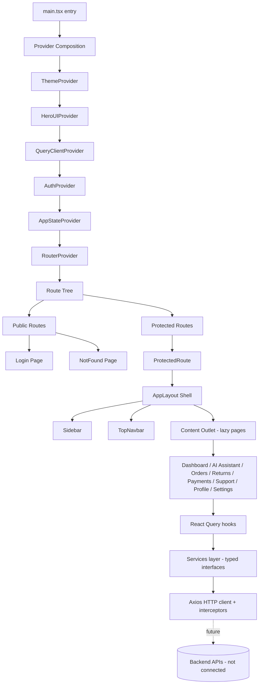
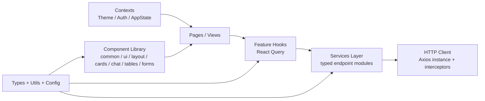
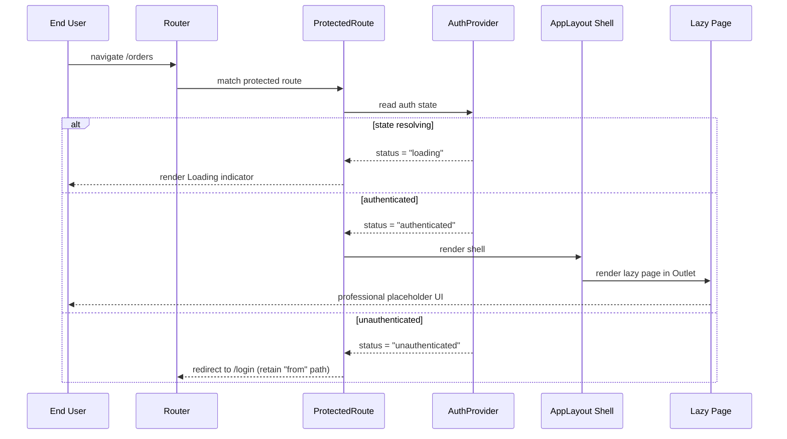

# Design Document: Generative AI Retail Customer Support Center (Frontend)

## Overview

This design describes the architecture and scaffolding for the **Generative AI Retail Customer Support Center** frontend: an enterprise-grade, production-ready React single-page application that will front an already-implemented backend (Amazon Bedrock Agent, Lambda, DynamoDB, API Gateway, Amazon Connect, Amazon Lex; Amazon Cognito planned for a later phase).

The scope is **architecture and scaffolding only**. This iteration establishes:

- A clean-slate, enterprise folder structure under `src/` (all default Vite template files removed).
- Provider composition (Theme + HeroUI v3 + React Query + Router + global App state + Auth).
- Routing with public/protected separation, lazy-loaded pages, and a persistent navigation shell.
- A theming system (blue-and-white enterprise aesthetic resembling Amazon Customer Support / Amazon Q Business) with light and dark modes.
- A typed HTTP client (Axios base instance + interceptors) and a services layer with typed interfaces — **no real API connections** in this iteration.
- A reusable component library built on HeroUI v3 + Tailwind CSS v4 (CSS-first config).
- Professional placeholder UIs for every page that compile and render using the reusable components.
- The AI Assistant chat shell prepared for future Bedrock/Lex integration.

**Fixed technology stack for this iteration:** React 19, TypeScript, Vite, HeroUI v3, Tailwind CSS v4 (CSS-first configuration as required by HeroUI v3), React Router, React Query (TanStack Query), Axios, Framer Motion.

> **Iteration scope note:** React Hook Form is **not** part of this iteration. Requirement 13 (Form Handling Foundation) is satisfied structurally only — a `components/forms/` directory and typed field-wrapper contracts are scaffolded, but React Hook Form is not integrated. Amazon Cognito remains future work; the Auth layer is designed behind an interface so it can be swapped in later without restructuring.

### Design Principles

1. **Separation of concerns** — views (pages) never talk to the network directly; they consume typed hooks that wrap the services layer, which wraps the shared HTTP client.
2. **Typed everywhere** — every component exposes a typed props interface; every service exposes typed request/response contracts.
3. **Barrel exports** — each directory exposes a public surface via an `index.ts` barrel to keep imports clean and stable.
4. **Lazy by default** — page modules are code-split via `React.lazy` and wrapped in Suspense + error boundaries.
5. **Swappable integrations** — Auth and AI-chat backends sit behind interfaces so real implementations drop in without touching views.
6. **Token-driven styling** — colors, spacing, and typography are defined once as theme tokens and referenced by components rather than hard-coded.

## Architecture

### High-Level Architecture



### Layered Responsibility



- **Presentation layer** (`pages/`, `components/`, `layouts/`) — pure rendering; consumes hooks and contexts.
- **Data-access layer** (`hooks/`, `services/`) — React Query hooks call typed service functions; services define endpoints.
- **Infrastructure layer** (`utils/http`, `config`, `contexts/`) — HTTP client, environment config, cross-cutting providers.

### Runtime Flow (route render)



## Folder and File Layout

All default Vite template artifacts are removed as part of scaffolding: `src/App.tsx`, `src/App.css`, `src/index.css` boilerplate content, `src/assets/react.svg`, and `public/vite.svg`. The `src/main.tsx` entry is rewritten. `index.html` root element is retained.

```
src/
├── main.tsx                     # Application entry — mounts <App/> into #root
├── App.tsx                      # Composes providers + RouterProvider
├── vite-env.d.ts                # Typed import.meta.env declarations
│
├── components/
│   ├── common/                  # PageHeader, Loading, ErrorState, EmptyState, ErrorBoundary
│   │   └── index.ts
│   ├── layout/                  # Sidebar, TopNavbar, ThemeToggle
│   │   └── index.ts
│   ├── cards/                   # StatCard, InfoCard, SectionCard
│   │   └── index.ts
│   ├── chat/                    # ChatWindow, MessageList, MessageBubble, MessageInput
│   │   └── index.ts
│   ├── forms/                   # FormField, FormSection contracts (RHF-ready, not integrated)
│   │   └── index.ts
│   ├── tables/                  # DataTable, TableSkeleton
│   │   └── index.ts
│   └── ui/                      # Thin re-exports/wrappers over HeroUI: Button, Input, Modal, Skeleton, Badge
│       └── index.ts
│
├── pages/
│   ├── Dashboard/               # DashboardPage + index.ts
│   ├── AIAssistant/             # AIAssistantPage (chat shell) + index.ts
│   ├── Orders/                  # OrdersPage + index.ts
│   ├── Returns/                 # ReturnsPage + index.ts
│   ├── Payments/                # PaymentsPage + index.ts
│   ├── Support/                 # SupportPage + index.ts
│   ├── Profile/                 # ProfilePage + index.ts
│   ├── Settings/                # SettingsPage + index.ts
│   ├── Login/                   # LoginPage (public) + index.ts
│   └── NotFound/                # NotFoundPage (public 404) + index.ts
│
├── layouts/
│   ├── AppLayout.tsx            # App shell: Sidebar + TopNavbar + <Outlet/>
│   └── index.ts
│
├── routes/
│   ├── router.tsx               # createBrowserRouter tree, lazy imports
│   ├── ProtectedRoute.tsx       # Route guard for protected routes
│   ├── paths.ts                 # Centralized route path constants
│   ├── navItems.ts              # Sidebar navigation config (order-controlled)
│   └── index.ts
│
├── services/
│   ├── ai/                      # aiChatService — send/receive message interface (no live calls)
│   ├── orders/                  # ordersService typed endpoints (scaffold)
│   ├── returns/
│   ├── payments/
│   ├── support/
│   ├── profile/
│   └── index.ts
│
├── contexts/
│   ├── ThemeContext.tsx         # ThemeProvider + useTheme
│   ├── AuthContext.tsx          # AuthProvider + useAuth (placeholder impl behind interface)
│   ├── AppStateContext.tsx      # AppStateProvider + useAppState (global client state)
│   └── index.ts
│
├── hooks/
│   ├── useMediaQuery.ts         # responsive helper (sidebar collapse)
│   ├── useLocalStorage.ts       # typed persistence helper
│   └── index.ts
│
├── types/
│   ├── auth.ts                  # AuthState, AuthUser, AuthContextValue
│   ├── chat.ts                  # ChatMessage, ChatRole, SendMessageRequest/Response
│   ├── api.ts                   # ApiError (normalized), ApiResult, pagination types
│   ├── theme.ts                 # ThemeMode, ThemeContextValue
│   ├── nav.ts                   # NavItem
│   └── index.ts
│
├── utils/
│   ├── http/
│   │   ├── client.ts            # Axios instance factory + interceptors
│   │   ├── normalizeError.ts    # normalize any thrown value -> ApiError
│   │   └── index.ts
│   ├── theme/
│   │   └── resolveTheme.ts      # resolve stored/system preference -> ThemeMode
│   └── index.ts
│
├── config/
│   ├── env.ts                   # typed Environment_Config (validated at startup)
│   ├── queryClient.ts           # QueryClient defaults (cache/retry/staleTime)
│   └── index.ts
│
├── assets/                      # static assets (logo, icons) — Vite boilerplate removed
│
└── styles/
    └── theme.css                # Tailwind v4 CSS-first config + HeroUI v3 tokens + dark variants
```

> **Requirements reconciliation:** Requirement 1.2/1.3 reference a "features directory". The authoritative folder decision for this iteration uses `pages/` for feature views plus dedicated cross-cutting directories (`services/`, `hooks/`, `contexts/`, `components/`). Each page directory is self-contained (view + barrel), preserving the "one directory per Feature_Area" intent while matching the required enterprise layout. Requirement 14.1 lists a "Products" Feature_Area; per the authoritative sidebar decision, Products is **not** included in this iteration's navigation or pages and is deferred to a later phase.

## Components and Interfaces

### Provider Composition (`App.tsx`)

Providers are composed outermost-to-innermost so that inner providers can consume outer ones (e.g., the HTTP client reads Auth; Query hooks run inside Auth + QueryClient):

```
ThemeProvider
  └─ HeroUIProvider
       └─ QueryClientProvider
            └─ AuthProvider
                 └─ AppStateProvider
                      └─ RouterProvider
```

```typescript
// App.tsx (shape)
export function App(): JSX.Element {
  return (
    <ThemeProvider>
      <HeroUIProvider>
        <QueryClientProvider client={queryClient}>
          <AuthProvider>
            <AppStateProvider>
              <RouterProvider router={router} />
              {import.meta.env.DEV && <ReactQueryDevtools initialIsOpen={false} />}
            </AppStateProvider>
          </AuthProvider>
        </QueryClientProvider>
      </HeroUIProvider>
    </ThemeProvider>
  );
}
```

### Layout Components

**AppLayout** (`layouts/AppLayout.tsx`) — the app shell composing Sidebar + TopNavbar + content Outlet.

```typescript
interface AppLayoutProps {
  children?: React.ReactNode; // normally renders <Outlet/>
}
```

Responsibilities: render responsive grid (sidebar column + main column), host `<TopNavbar/>` and `<Sidebar/>`, and render the routed page in `<Outlet/>` wrapped by a Suspense boundary (Loading fallback) and an ErrorBoundary.

**Sidebar** (`components/layout/Sidebar.tsx`) — collapsible/responsive vertical navigation.

```typescript
interface SidebarProps {
  items: NavItem[];
  collapsed: boolean;
  onToggle: () => void;
}
```

Renders the fixed navigation items in order, highlights the active item using React Router's `NavLink` active state, and collapses to an icon rail (or drawer) below the `md` breakpoint via `useMediaQuery`.

**TopNavbar** (`components/layout/TopNavbar.tsx`) — top application bar.

```typescript
interface TopNavbarProps {
  onMenuClick: () => void; // toggles sidebar on small screens
}
```

Hosts the product title/brand, a sidebar toggle, the `ThemeToggle`, and a user menu placeholder (sign-out wired to `useAuth().signOut`).

**PageHeader** (`components/common/PageHeader.tsx`) — standardized page title block.

```typescript
interface PageHeaderProps {
  title: string;
  description?: string;
  actions?: React.ReactNode; // right-aligned action slot
  breadcrumbs?: { label: string; to?: string }[];
}
```

### Common / Feedback Components

```typescript
// Loading — full-area or inline spinner
interface LoadingProps {
  label?: string;
  fullscreen?: boolean;
  size?: "sm" | "md" | "lg";
}

// ErrorState — recoverable error display
interface ErrorStateProps {
  title?: string;
  message: string;
  onRetry?: () => void;
  homeHref?: string; // control to return to a stable route
}

// EmptyState — no-data placeholder
interface EmptyStateProps {
  title: string;
  description?: string;
  icon?: React.ReactNode;
  action?: React.ReactNode;
}

// ErrorBoundary — class component catching render errors
interface ErrorBoundaryProps {
  fallback?: React.ComponentType<{ error: Error; reset: () => void }>;
  children: React.ReactNode;
}
interface ErrorBoundaryState {
  error: Error | null;
}
```

### UI Wrappers (`components/ui/`)

Thin, typed re-exports/wrappers over HeroUI v3 primitives so the rest of the app imports from a stable internal surface: `Button`, `Input`, `Modal`, `Card`, `Skeleton`, `Badge`. This isolates the app from HeroUI API churn and centralizes token application.

### Card Components (`components/cards/`)

```typescript
interface StatCardProps {
  label: string;
  value: string | number;
  delta?: { value: number; direction: "up" | "down" };
  icon?: React.ReactNode;
  loading?: boolean;
}

interface SectionCardProps {
  title: string;
  footer?: React.ReactNode;
  children: React.ReactNode;
}
```

### Table Components (`components/tables/`)

```typescript
interface Column<T> {
  key: keyof T | string;
  header: string;
  render?: (row: T) => React.ReactNode;
  align?: "start" | "center" | "end";
}

interface DataTableProps<T> {
  columns: Column<T>[];
  rows: T[];
  loading?: boolean;      // renders TableSkeleton
  emptyMessage?: string;  // renders EmptyState
  getRowId: (row: T) => string;
}
```

### Chat Components (`components/chat/`) — AI Assistant shell

```typescript
type ChatRole = "user" | "assistant" | "system";

interface ChatMessage {
  id: string;
  role: ChatRole;
  content: string;
  createdAt: string; // ISO timestamp
  pending?: boolean;
}

interface ChatWindowProps {
  messages: ChatMessage[];
  onSend: (content: string) => void;
  isSending: boolean;
}

interface MessageListProps {
  messages: ChatMessage[];
}

interface MessageBubbleProps {
  message: ChatMessage;
}

interface MessageInputProps {
  onSend: (content: string) => void;
  disabled?: boolean;
  placeholder?: string;
}
```

The chat shell renders a scrollable `MessageList` + a pinned `MessageInput`. `onSend` is wired to a `useSendMessage` mutation that calls `aiChatService.sendMessage` — which returns a mocked/placeholder response in this iteration (no live Bedrock/Lex call).

### Forms (`components/forms/`) — RHF-ready contracts (not integrated this iteration)

```typescript
// Contract only — React Hook Form wiring deferred to a later iteration.
interface FormFieldProps {
  name: string;
  label: string;
  error?: string;      // field-level validation message slot
  required?: boolean;
  children: React.ReactNode; // control (Input, Select, etc.)
}
```

### Contexts

```typescript
// ThemeContext
type ThemeMode = "light" | "dark";
interface ThemeContextValue {
  mode: ThemeMode;
  setMode: (mode: ThemeMode) => void;
  toggle: () => void;
}

// AuthContext
type AuthStatus = "loading" | "authenticated" | "unauthenticated";
interface AuthUser {
  id: string;
  displayName: string;
  email?: string;
}
interface AuthContextValue {
  status: AuthStatus;
  user: AuthUser | null;
  getToken: () => string | null;
  signIn: (from?: string) => Promise<void>;
  signOut: () => Promise<void>;
  refreshSession: () => Promise<void>;
}

// AppStateContext (global client state, not server data)
interface AppState {
  sidebarCollapsed: boolean;
}
interface AppStateContextValue {
  state: AppState;
  setSidebarCollapsed: (collapsed: boolean) => void;
}
```

**Auth interface isolation:** `AuthProvider` depends on an `AuthClient` interface. The default `PlaceholderAuthClient` reports `unauthenticated` unless the dev flag `VITE_AUTH_BYPASS=true` is set (then `authenticated` with a mock user). A future `CognitoAuthClient` implements the same interface with no changes to consumers.

```typescript
interface AuthClient {
  getSession(): Promise<AuthUser | null>;
  signIn(): Promise<AuthUser>;
  signOut(): Promise<void>;
  getToken(): string | null;
}
```

### Routing (`routes/`)

**Path constants** (`paths.ts`) centralize all routes:

```typescript
export const PATHS = {
  root: "/",
  dashboard: "/dashboard",
  aiAssistant: "/ai-assistant",
  orders: "/orders",
  returns: "/returns",
  payments: "/payments",
  support: "/support",
  profile: "/profile",
  settings: "/settings",
  login: "/login",
  notFound: "*",
} as const;
```

**Sidebar navigation config** (`navItems.ts`) — exact order, nothing else:

```typescript
export const NAV_ITEMS: NavItem[] = [
  { label: "Dashboard",        to: PATHS.dashboard,   icon: "layout-dashboard" },
  { label: "AI Assistant",     to: PATHS.aiAssistant, icon: "sparkles" },
  { label: "My Orders",        to: PATHS.orders,      icon: "package" },
  { label: "Returns & Refunds",to: PATHS.returns,     icon: "rotate-ccw" },
  { label: "Payments",         to: PATHS.payments,    icon: "credit-card" },
  { label: "Support Tickets",  to: PATHS.support,     icon: "life-buoy" },
  { label: "Profile",          to: PATHS.profile,     icon: "user" },
  { label: "Settings",         to: PATHS.settings,    icon: "settings" },
];
```

**ProtectedRoute** (`ProtectedRoute.tsx`):

```typescript
interface ProtectedRouteProps {
  children: React.ReactNode;
}
// Behavior:
// - status === "loading"        -> render <Loading fullscreen/>
// - status === "unauthenticated"-> <Navigate to={PATHS.login} state={{ from }} replace/>
// - status === "authenticated"  -> render children
```

**Route map:**

| Path | Access | Page | In Sidebar |
|------|--------|------|------------|
| `/` | protected | redirect → `/dashboard` | — |
| `/dashboard` | protected | DashboardPage | Yes (1) |
| `/ai-assistant` | protected | AIAssistantPage | Yes (2) |
| `/orders` | protected | OrdersPage | Yes (3) |
| `/returns` | protected | ReturnsPage | Yes (4) |
| `/payments` | protected | PaymentsPage | Yes (5) |
| `/support` | protected | SupportPage | Yes (6) |
| `/profile` | protected | ProfilePage | Yes (7) |
| `/settings` | protected | SettingsPage | Yes (8) |
| `/login` | public | LoginPage | No |
| `*` | public | NotFoundPage | No |

All protected pages render inside `AppLayout` behind `ProtectedRoute`; each page module is lazy-loaded via `React.lazy` + Suspense.

### Services Layer (`services/`)

Services define typed endpoint functions that use the shared HTTP client. In this iteration they expose typed signatures and return mock/placeholder data (no live network calls).

```typescript
// services/ai/aiChatService.ts (shape)
export interface AiChatService {
  sendMessage(req: SendMessageRequest): Promise<SendMessageResponse>;
}
// Placeholder implementation resolves a canned assistant response.
```

### Data Layer — React Query hooks convention

Each feature owns hooks that wrap its service. Convention:

- Query keys: array-form namespaced by feature, e.g. `["orders", "list", params]`.
- Query hooks: `useOrders()`, `useOrder(id)` — return React Query result (`data/isLoading/isError`).
- Mutation hooks: `useSendMessage()` — wraps `aiChatService.sendMessage`, handles optimistic pending bubble.
- Hooks live in the consuming page directory or `hooks/` when cross-cutting; all call through `services/`.

```typescript
// Example convention
export function useSendMessage() {
  return useMutation({
    mutationFn: (req: SendMessageRequest) => aiChatService.sendMessage(req),
  });
}
```

### HTTP Client (`utils/http/client.ts`)

An Axios instance created from a factory, with request/response interceptors:

- **Base config**: `baseURL` from `config/env.ts`, JSON headers, timeout.
- **Request interceptor**: attach `Authorization: Bearer <token>` when `authClient.getToken()` returns a token.
- **Response interceptor (success)**: pass through `response.data`.
- **Response interceptor (error)**:
  - On HTTP 401/403 → invoke `authClient.signOut()`; if that throws or is unavailable → clear local auth state and force reload to a public route (`/login`).
  - For any failure → reject with a **normalized `ApiError`** produced by `normalizeError`.

```typescript
interface ApiError {
  status: number;   // 0 when no HTTP response (network/unknown)
  message: string;  // always a non-empty human-readable string
  code?: string;
  details?: unknown;
}
```

The client is exported as a single shared singleton consumed by all services.

### Environment Config (`config/env.ts`)

```typescript
interface EnvConfig {
  apiBaseUrl: string;
  authBypass: boolean;
}
// - Reads import.meta.env (VITE_API_BASE_URL, VITE_AUTH_BYPASS)
// - Applies local-dev defaults (e.g., apiBaseUrl = "http://localhost:3000")
// - Throws a descriptive error and halts startup if a required var is missing with no default
```

## Data Models

### Theme

```typescript
type ThemeMode = "light" | "dark";

// Persistence shape in localStorage under key "app.theme"
// stored value is exactly the ThemeMode string ("light" | "dark")
```

### Auth

```typescript
type AuthStatus = "loading" | "authenticated" | "unauthenticated";

interface AuthUser {
  id: string;
  displayName: string;
  email?: string;
}

interface AuthSession {
  user: AuthUser;
  token: string;
}
```

### Chat

```typescript
type ChatRole = "user" | "assistant" | "system";

interface ChatMessage {
  id: string;
  role: ChatRole;
  content: string;
  createdAt: string; // ISO 8601
  pending?: boolean;
}

interface SendMessageRequest {
  conversationId?: string;
  content: string;
}

interface SendMessageResponse {
  conversationId: string;
  message: ChatMessage; // role === "assistant"
}
```

### API / Error

```typescript
interface ApiError {
  status: number;
  message: string;
  code?: string;
  details?: unknown;
}

interface Paginated<T> {
  items: T[];
  total: number;
  page: number;
  pageSize: number;
}
```

### Navigation

```typescript
interface NavItem {
  label: string;
  to: string;
  icon: string; // icon key
}
```

### Design tokens (theme)

Defined in `styles/theme.css` using Tailwind v4 CSS-first `@theme` and HeroUI v3 theme tokens, with dark-mode variants. Enterprise blue-and-white palette:

```
Primary (blue):   50 #eff6ff … 500 #2563eb (brand) … 700 #1d4ed8 … 900 #1e3a8a
Neutral (gray):   50 #f8fafc … 200 #e2e8f0 (borders) … 500 #64748b … 900 #0f172a
Surface (light):  background #ffffff, elevated #f8fafc, border #e2e8f0
Surface (dark):   background #0f172a, elevated #1e293b, border #334155
Semantic:         success #16a34a, warning #d97706, danger #dc2626, info #2563eb
Typography:       Inter / system-ui stack; scale sm/base/lg/xl/2xl
Radius:           md 0.5rem, lg 0.75rem; Spacing: 4px base grid
```

## Correctness Properties

*A property is a characteristic or behavior that should hold true across all valid executions of a system — essentially, a formal statement about what the system should do. Properties serve as the bridge between human-readable specifications and machine-verifiable correctness guarantees.*

Although this iteration is largely scaffolding, a small number of pure, input-varying logic units carry genuine correctness risk and are ideal for property-based testing: theme resolution/persistence, the route-guard decision, the HTTP request/error handling, and environment validation. The remaining acceptance criteria (UI rendering, provider wiring, routing configuration) are validated by example-based unit tests, snapshot tests, and integration tests as described in the Testing Strategy — property-based testing is intentionally not applied to those.

### Property 1: Theme persistence round-trip

*For any* `ThemeMode` value, persisting that mode to storage and then loading the stored preference SHALL return the same `ThemeMode`.

**Validates: Requirements 4.4, 4.5**

### Property 2: Theme resolution precedence

*For any* combination of stored preference (absent, `"light"`, or `"dark"`) and operating-system color-scheme preference (`"light"` or `"dark"`), `resolveTheme` SHALL return the stored preference when one is present, and otherwise SHALL return the operating-system preference.

**Validates: Requirements 4.3**

### Property 3: Route guard decision by authentication status

*For any* requested route path, the route-guard decision SHALL depend only on authentication status such that: when status is `loading` it yields a loading indicator, when status is `unauthenticated` it yields a redirect to the login route and renders no protected content, and when status is `authenticated` it renders the requested content.

**Validates: Requirements 7.2, 7.3, 7.5**

### Property 4: Requested-path retention on redirect

*For any* protected route path to which an unauthenticated user navigates, the redirect to the login route SHALL carry that exact originally requested path so that post-authentication navigation returns to it.

**Validates: Requirements 7.4**

### Property 5: Conditional authentication header attachment

*For any* outbound request configuration and any token state, the HTTP client request interceptor SHALL attach an `Authorization` header carrying the current token if and only if a token is available, leaving other request configuration unchanged.

**Validates: Requirements 10.2**

### Property 6: Error normalization totality

*For any* error value encountered during a request (Axios error with a response, network error without a response, or an arbitrary thrown value), `normalizeError` SHALL return an `ApiError` whose `status` is a number (0 when no HTTP response is present) and whose `message` is a non-empty string.

**Validates: Requirements 10.5**

### Property 7: Environment validation completeness

*For any* environment input that is missing a required value having no default, `validateEnv` SHALL throw a descriptive configuration error; *for any* environment input that supplies all required values (directly or via defaults), `validateEnv` SHALL return a fully populated typed `EnvConfig`.

**Validates: Requirements 11.3**

## Error Handling

### HTTP / network errors
- All request failures pass through `normalizeError`, producing a consistent `ApiError { status, message, code?, details? }`. `status` is `0` when there is no HTTP response. `message` is always non-empty (falls back to a generic message when none is available).
- **401/403**: the response interceptor invokes `authClient.signOut()`. If sign-out throws or the client is unavailable, the interceptor clears local auth state and forces a reload to `/login` (Requirements 10.3, 10.4).
- React Query surfaces normalized errors to consuming components as `isError`/`error`; pages render `<ErrorState onRetry={refetch}/>`.

### Rendering errors
- `ErrorBoundary` wraps the content `<Outlet/>` inside `AppLayout`. On a render error it renders a fallback (`ErrorState`) with a control that returns the user to a stable route (`/dashboard` or `/`) (Requirements 16.2, 16.3).
- Lazy page loading failures (chunk load errors) are caught by the same boundary; the fallback offers a retry/reload control.

### Loading states
- Suspense fallback for lazy pages renders `<Loading/>` (Requirement 16.1).
- `ProtectedRoute` renders `<Loading fullscreen/>` while auth status is `loading` (Requirement 7.5).

### Environment / startup errors
- `config/env.ts` validates required variables at module load. A missing required value throws a descriptive error that halts startup, surfacing the misconfiguration immediately rather than failing later (Requirement 11.3).

## Testing Strategy

This iteration mixes pure logic (property-testable) with UI/configuration (best covered by example, snapshot, and integration tests). The strategy uses a dual approach and applies property-based testing **only** where universal input-varying behavior exists.

### Tooling
- **Test runner**: Vitest (native Vite integration, TS + ESM support).
- **Component testing**: React Testing Library + `@testing-library/jest-dom`.
- **Property-based testing**: `fast-check` (do not hand-roll property testing).
- **Router/context testing**: render with `MemoryRouter` / provider wrappers.

### Property-based tests (minimum 100 iterations each)
Each property test is tagged with a comment referencing its design property, using the format:
`// Feature: retail-customer-assistant-frontend, Property {number}: {property_text}`

- **Property 1 — Theme persistence round-trip**: generate arbitrary `ThemeMode`; assert `load(persist(mode)) === mode`.
- **Property 2 — Theme resolution precedence**: generate `{stored ∈ [absent, light, dark]} × {system ∈ [light, dark]}`; assert stored wins else system.
- **Property 3 — Guard decision by status**: generate arbitrary path × auth status; assert loading→Loading, unauthenticated→redirect + no protected content, authenticated→content.
- **Property 4 — Path retention**: generate arbitrary protected path; assert redirect `state.from` equals the requested path.
- **Property 5 — Token attachment**: generate arbitrary request config × token state; assert header present iff token available and other config unchanged.
- **Property 6 — Error normalization totality**: generate Axios errors (with/without response), network errors, and arbitrary thrown values; assert `status` is number and `message` is non-empty.
- **Property 7 — Env validation completeness**: generate env objects with/without required keys; assert throw on missing-required and typed config otherwise.

### Unit tests (example-based)
- Theme toggle applies DOM class/attribute for light and dark; applies OS preference when unset.
- `AuthProvider` placeholder reports `unauthenticated` by default and `authenticated` under `VITE_AUTH_BYPASS`; sign-out clears session.
- `AppStateProvider` typed accessors read/update `sidebarCollapsed`.
- Interceptor 401/403 path invokes sign-out; sign-out failure clears state and forces reload (mocked).
- Component library: `Loading`, `ErrorState` (renders return-home control), `EmptyState`, `DataTable` (skeleton while loading, empty message when no rows), `StatCard`.

### Integration tests
- Router renders each protected page inside `AppLayout` when authenticated; redirects to `/login` when unauthenticated; unknown path renders `NotFound`.
- Sidebar renders exactly the eight navigation items in order and marks the active item.
- AI Assistant shell: submitting a message via `MessageInput` triggers `useSendMessage` and appends the (mocked) assistant response to `MessageList`.
- Error boundary: a page that throws during render shows the fallback with a working return-to-stable-route control.

### Snapshot / structural tests
- Page placeholders (Dashboard, Orders, Returns, Payments, Support, Profile, Settings, Login, NotFound) render headings via `PageHeader` and compile without type errors.
- Build/lint smoke: `tsc --noEmit` (strict) passes; `vite build` produces a bundle; lint reports cleanly.

### Coverage rationale
Property tests concentrate on the seven pure logic units where input variation reveals edge cases (theme resolution, guard decisions, HTTP handling, env validation). Everything else — provider composition, HeroUI/Tailwind configuration, lazy loading, React Query wiring, and page placeholders — is deterministic UI/config verified more cost-effectively by example, integration, and snapshot tests, consistent with the guidance that PBT is not applied to UI rendering, simple wiring, or configuration.

## Design Decisions and Requirements Mapping

| Design decision | Rationale | Requirements |
|---|---|---|
| Enterprise `src/` layout with `pages/`, `components/*`, `services/`, `contexts/`, `hooks/`, `routes/`, `types/`, `utils/`, `config/`, `styles/`, barrel exports | Consistent, scalable organization separating reuse from feature views and config from features | 1.1–1.5, 5, 12 |
| Vite + React 19 + TS strict; Tailwind v4 in Vite pipeline; lint command | Reliable dev/prod builds with strict typing | 2.1–2.7 |
| HeroUIProvider at root; Tailwind v4 CSS-first `@theme`; shared tokens in `styles/theme.css` | Shared, token-driven design system | 3.1–3.5 |
| `ThemeProvider` with light/dark, localStorage persistence, OS-preference fallback, `ThemeToggle` | User-selectable, persistent theming | 4.1–4.5 (Properties 1, 2) |
| `createBrowserRouter` with `paths.ts`, lazy pages, `AppLayout` shell, `NavLink` active state, NotFound | Direct URL navigation, lazy loading, persistent nav | 5.1–5.6 |
| `AuthProvider` behind `AuthClient` interface; `PlaceholderAuthClient`; `VITE_AUTH_BYPASS` flag | Cognito-ready without restructuring | 6.1–6.6 |
| `ProtectedRoute` with loading/redirect/render decision and `from` retention | Guard protected content; return to origin after login | 7.1–7.5 (Properties 3, 4) |
| `AppStateProvider` (Context) for client-only global state; server data stays in React Query | No prop drilling; no server/client state duplication | 8.1–8.5 |
| `QueryClient` in `config/queryClient.ts`; hooks convention; Devtools in DEV | Consistent, cached server-state access | 9.1–9.5 |
| Axios singleton with interceptors; `normalizeError`; base URL from env | Consistent base config, auth headers, normalized errors | 10.1–10.7 (Properties 5, 6) |
| Typed `env.ts` from `import.meta.env` with defaults and startup validation | Centralized, validated configuration | 11.1–11.4 (Property 7) |
| Component library: layout (`AppLayout`, `Sidebar`, `TopNavbar`, `PageHeader`), UI (HeroUI wrappers), feedback (`Loading`, `ErrorState`, `EmptyState`), cards, tables, chat, Framer Motion transition wrappers | Consistent, accessible, animated building blocks | 12.1–12.6 |
| `components/forms/` contracts scaffolded (RHF deferred this iteration) | Structure ready; RHF integration later | 13.1–13.4 (deferred) |
| One page per Feature_Area with professional placeholder UI built from the component library, lazy + guarded | Complete routable structure without business logic | 14.1–14.7 |
| AI Assistant chat shell (`ChatWindow`/`MessageList`/`MessageInput`) + `aiChatService` interface (mocked) | Bedrock/Lex-ready without view changes | 15.1–15.4 |
| Suspense `Loading` fallback + `ErrorBoundary` with return-to-stable-route control | Graceful loading/error handling | 16.1–16.3 |

### Noted deviations from requirements.md (per authoritative iteration decisions)
- **React Hook Form**: listed in the requirements stack but excluded from this iteration. `components/forms/` provides RHF-ready contracts only; Requirement 13 is satisfied structurally and full RHF integration is deferred.
- **Products Feature_Area** (Requirement 14.1): not part of this iteration's sidebar or pages. The navigation is fixed to the eight items specified (Dashboard, AI Assistant, My Orders, Returns & Refunds, Payments, Support Tickets, Profile, Settings). Products is deferred to a later phase.
