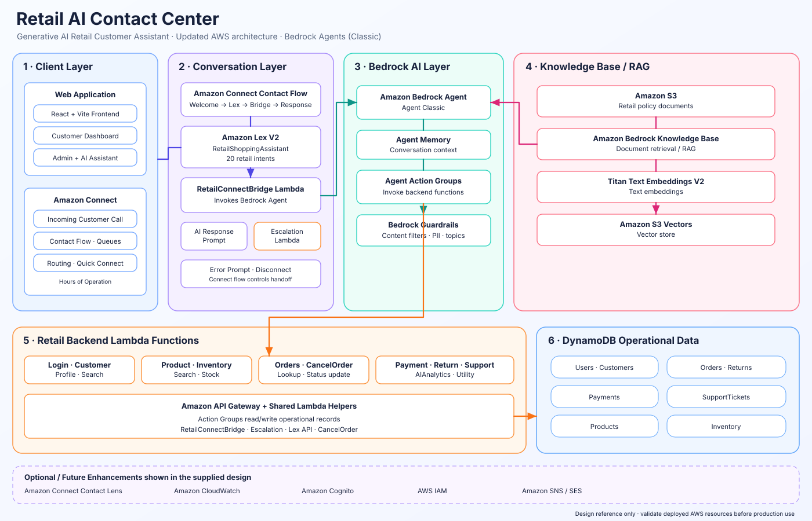

# Retail AI Contact Center — AWS Architecture

[Agent Classic master prompt — Product Routing v5.0](agent-classic-master-prompt.md)

This diagram documents the architecture shown in the project's updated architecture image. It describes the intended design; it is not proof that every resource is deployed.

## Architecture diagram

~~~mermaid
flowchart LR
  subgraph Client["Client Layer"]
    Users["Customer / Admin Users"]
    Web["React + Vite Frontend Customer Dashboard · Admin Dashboard · AI Assistant"]
    Users --> Web
  end

  subgraph Conversation["Conversation Layer"]
    Connect["Amazon Connect Contact Flow / Queues / Routing"]
    Lex["Amazon Lex V2 RetailShoppingAssistant"]
    Bridge["RetailConnectBridge Lambda"]
    Escalation["Escalation Lambda Human-agent handoff"]
    Connect --> Lex
    Lex <--> Bridge
    Connect -. Escalation flow .-> Escalation
  end

  APIGW["Amazon API Gateway"]

  subgraph AI["Amazon Bedrock AI Layer"]
    Agent["Amazon Bedrock Agent"]
    Memory["Agent Memory"]
    Actions["Agent Action Groups Invoke backend functions"]
    Guardrails["Bedrock Guardrails"]
    Agent <--> Memory
    Agent --> Actions
    Agent --> Guardrails
  end

  subgraph RAG["Knowledge Base / RAG"]
    Docs["Amazon S3 Retail documents"]
    KB["Amazon Bedrock Knowledge Base"]
    Embeddings["Titan Text Embeddings V2"]
    Vectors["Amazon S3 Vectors"]
    Docs --> KB
    KB --> Embeddings
    Embeddings --> Vectors
  end

  subgraph Backend["Retail Backend Lambda Functions"]
    Login["User Login Lambda"]
    Customer["Customer Lookup Lambda"]
    Product["Product Lookup Lambda"]
    Inventory["Inventory Lookup Lambda"]
    Payment["Payment Lookup Lambda"]
    Returns["Return Lookup Lambda"]
    Support["Support Ticket Lookup Lambda"]
    Order["Order Lookup / order utilities"]
    Analytics["AIAnalytics Lambda"]
    Other["Other utility functions"]
  end

  subgraph Data["Amazon DynamoDB — Operational Data"]
    UsersDB[(Users)]
    CustomersDB[(Customers)]
    OrdersDB[(Orders)]
    ReturnsDB[(Returns)]
    PaymentsDB[(Payments)]
    SupportDB[(SupportTickets)]
    ProductsDB[(Products)]
    InventoryDB[(Inventory)]
  end

  Web --> APIGW
  APIGW --> Backend
  Bridge <--> Agent
  Agent <--> KB
  Actions --> Backend
  Backend <--> Data

  subgraph Future["Optional / Future Enhancements"]
    ContactLens["Amazon Connect Contact Lens"]
    CloudWatch["Amazon CloudWatch"]
    Cognito["Amazon Cognito"]
    IAM["AWS IAM"]
    SNS["Amazon SNS / SES"]
  end

  Web -. Authentication .-> Cognito
~~~

## Component responsibilities

- React + Vite: customer/admin interface, dashboards, order/payment/return pages, and AI Assistant.
- API Gateway: HTTP entry point for frontend backend calls.
- Lambda: serverless request handlers, Bedrock Action Group tools, analytics, bridge, and escalation workflows.
- DynamoDB: operational records for users, customers, orders, returns, payments, support tickets, products, and inventory.
- Amazon Connect + Lex V2: voice contact flow and intent capture.
- RetailConnectBridge: passes conversational requests to the Bedrock Agent and returns responses in the expected channel format.
- Bedrock Agent: coordinates response generation, memory, action execution, and knowledge retrieval.
- Bedrock Knowledge Base: retrieves retail policy documents stored in S3; Titan Text Embeddings V2 and S3 Vectors support semantic retrieval.
- Guardrails: configured controls for content and sensitive-information handling.
- Escalation Lambda: supports routing a conversation to human assistance.

## Lex intents

The updated architecture image lists 20 intents: ExpressDelivery, CancelOrder, ExchangePolicy, CustomerProfile, PaymentMethods, ProductSearch, ContactSupport, OrderStatus, ShippingPolicy, ShippingCost, StoreLocation, FallbackIntent, BusinessHours, Offers, DeliveryTime, Exit, ReturnPolicy, Warranty, Greeting, and LiveAgent.

Verify intent availability against the deployed Lex bot version and locale.

## Architecture notes

- The image includes User Login, Customer Lookup, Product Lookup, Inventory Lookup, Payment Lookup, Return Lookup, Support Ticket Lookup, and Other Utility Lambda. Historical progress reports also explicitly identify Order Lookup, RetailConnectBridge, and EscalationLambda.
- AIAnalytics, customer profile/search, order-status update, and website Lex API are included in the repository inventory because frontend code or project context references them. Verify deployed function boundaries before treating each as a separate Lambda.
- Cognito, CloudWatch, Contact Lens, IAM, and SNS/SES are marked optional/future in the diagram.
- The project has also explored AgentCore/Gateway work. Keep those experiments documented separately from this Bedrock Agent + Lex/Connect architecture unless the deployment is intentionally migrated.
